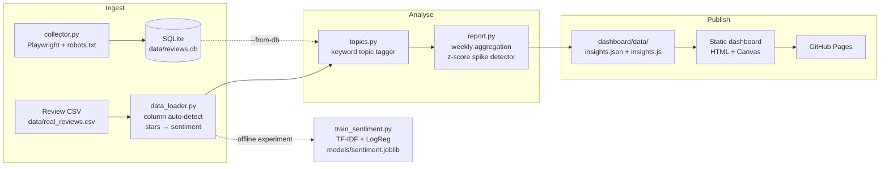

<!-- TODO: replace <username>/<repo> in the links below once the repo is on GitHub -->

<div align="center">

# 📊 Review Insight Agent

**Turn thousands of raw app-store reviews into a prioritised, alert-ready engineering signal.**

Ingest reviews → derive sentiment → tag operational topics → detect complaint spikes → publish a zero-dependency dashboard.

[](https://<username>.github.io/<repo>/)
[](https://www.python.org/)
[](https://scikit-learn.org/)
[](https://playwright.dev/)
[](#-the-dashboard)
[](#-the-dashboard)

[**Live demo**](https://<username>.github.io/<repo>/) · [Quick start](#-quick-start) · [How it works](#-how-it-works) · [Limitations](#-honest-limitations)

</div>

---

## 🎯 What is this?

Product teams drown in app-store reviews. Star averages hide *what* is going wrong, and by the time someone notices a bad release, thousands of users have already complained.

**Review Insight Agent** is a small, auditable analytics pipeline that answers three questions:

1. **How do users feel?** — sentiment split and week-by-week trend.
2. **What are they upset about?** — complaints bucketed into engineering-relevant areas (crashes, updates, login/sync, performance, battery/data, privacy, ads).
3. **Did something just break?** — a z-score detector flags a topic whose negative-review volume surges in the latest week.

Results are exported as a single JSON file and rendered by a **static dashboard** (plain HTML, CSS and Canvas — no framework, no bundler, no hosting cost).

> **Demo dataset:** 7,204 historical Google Chrome (Android) Play Store reviews, **19 Dec 2020 – 5 Mar 2021**. This is a *historical batch analysis*, not a live feed.

---

## ✨ Highlights

| | |
|---|---|
| 🧩 **Schema-agnostic loader** | Auto-detects text / rating / label / date columns (`Text`, `reviewText`, `Star`, `overall`, `Review Date`, …), so Kaggle, Amazon, Flipkart and Play Store exports work without wrangling. |
| 🏷️ **Auditable topic tagging** | ~180 regex keyword rules across 7 operational buckets. Deterministic, instantly debuggable, maps straight to a backlog. Generic praise ("good", "nice") is deliberately *not* a topic. |
| 🚨 **Explainable anomaly alerts** | Per-topic z-score + surge-ratio rule with a minimum-volume guard. No black box — every alert prints its baseline, count and z-score. |
| 🧪 **Safe spike testing** | `--inject-spike` simulates a complaint surge and writes to a temp file, so you can prove the detector works **without touching the published dashboard data**. |
| 🌐 **Zero-build dashboard** | Native Canvas charts, filterable review table, works over HTTP *and* by double-clicking `index.html` (`file://`). |
| 🕷️ **Polite collector** | Playwright + SQLite collector that honours `robots.txt`, rate-limits requests, and falls back to local CSV when offline. |
| 🔒 **Privacy-conscious by design** | Raw review dump is git-ignored; the published JSON contains only aggregates and ≤100-character excerpts (no usernames, URLs or IDs). |
| 🤖 **Hands-off deploys** | GitHub Actions publishes `dashboard/` to GitHub Pages on every push that changes it. |

---

## 📈 Results at a glance

Computed from the Chrome review archive (labels derived from star ratings — see [How sentiment is defined](#how-sentiment-is-defined)).

| Metric | Value |
| :-- | :-- |
| Reviews analysed | **7,204** ¹ |
| Positive (4–5★) / Neutral (3★) / Negative (1–2★) | **62.8%** / **6.3%** / **31.0%** |
| Largest complaint driver | **`updates`** — 1,244 negative reviews, **77.8%** of all `updates`-tagged reviews are negative |
| Active spike alerts (latest week, 1–7 Mar 2021) | **0** — all topics within expected variance |
| Text-only sentiment baseline (TF-IDF + LogReg) | **≈75% accuracy**, macro-F1 ≈ 0.54 |

<sub>¹ The committed dashboard snapshot reports 7,204. A fresh local run drops 2 rows with empty review text and reports 7,202; every percentage above is unchanged.</sub>

### Where the negative reviews go

Topics are **multi-label** (a review can match several), so bars add up to more than the number of negative reviews.

| Topic | Negative reviews | Share of topic that is negative | What triggers it |
| :-- | --: | --: | :-- |
| `updates` | **1,244** | 77.8% | update, version, download, install, upgrade, pending, stuck, play store |
| `crashes/bugs` | **421** | 75.0% | crash, freeze, error, bug, glitch, not working, blank/black screen, force close |
| `login/sync` | **173** | 74.9% | sync, login, sign in, account, password, bookmarks, history, tabs |
| `speed/performance` | **123** | 39.9% | slow, lag, sluggish, loading, ram, memory, cache, performance |
| `battery/data` | **51** | 63.0% | battery, drain, heat, mobile data, wifi, network, offline |
| `privacy` | **36** | 46.8% | privacy, tracking, permissions, incognito, spyware, cookies |
| `ads` | **26** | 74.3% | ads, popups, banners, spam, advertisement |
| *other / unclassified* | *669 (30.0% of negatives)* | 13.4% | short feedback with no operational keyword |

> 💡 `speed/performance` is only ~40% negative because words like *fast* and *smooth* are mostly used in **praise** — a good illustration of why topic ≠ sentiment, and why the dashboard cross-tabs both.

---

## 🧠 How it works



### 1. Load & normalise — [`data_loader.py`](data_loader.py)

Matches column names case- and punctuation-insensitively, then standardises everything to `text`, `label` and (optionally) `date`. Source priority when no path is given: `data/real_reviews.csv` → `data/sample_reviews.csv` → `data/reviews.csv`.

### How sentiment is defined

Sentiment labels come straight from the **star rating**:

| Stars | Label |
| :-: | :-- |
| 1–2 | `negative` |
| 3 | `neutral` |
| 4–5 | `positive` |

If a dataset has no rating column, a pre-existing `label` / `sentiment` column is used instead.

> **Important:** the dashboard's KPIs and trend lines are computed from these rating-derived labels. The trained classifier in `train_sentiment.py` is a **separate, offline baseline** that measures how well *text alone* predicts the star bucket — it is not in the `report.py` path. See [the model section](#-sentiment-baseline-model).

### 2. Tag topics — [`topics.py`](topics.py)

Each review is matched against compiled, word-boundary regexes for seven operational areas; no match → `other`. A review keeps **all** matching topics (used for the topic charts) and a **primary topic** — the first match in dictionary order — used for spike detection so each negative review is counted once.

Why rules instead of a model? They are deterministic, need no labelled data, and when an alert fires you can point to the exact word that caused it.

### 3. Detect spikes — [`report.py`](report.py)

For each topic, negative reviews (by primary topic) are counted per calendar week. The **latest** week is compared with all earlier weeks:

```text
z      = (latest − mean(history)) / std(history)      # if std = 0: latest − mean
ratio  = latest / mean(history)

ALERT  if  latest ≥ 3  AND  (z ≥ 1.3  OR  ratio ≥ 1.5)
```

- The `latest ≥ 3` guard stops tiny absolute numbers from triggering alarms.
- `threshold_z` (default `1.3`) is a parameter of `detect_spikes()` — raise it for fewer, higher-confidence alerts.
- If the data has no usable dates, the pipeline falls back to equal-sized review **batches** and labels the dashboard accordingly instead of pretending they are weeks.

**Proof it works** — injecting 45 synthetic `login/sync` complaints into the final week:

```console
$ python report.py --inject-spike login/sync
[TEST] Injected spike output written to temporary path: data/test_spike_insights.json (dashboard/data was NOT modified).
Total reviews: 7,247 | Active Alerts: 1
  --> ALERT: Critical spike in 'login/sync': 54 complaints in 2021-03-01/2021-03-07 (baseline avg: 6.7) (z-score: 8.69)
```

### 4. Publish — `dashboard/data/`

`report.py` writes the same payload twice:

- `insights.json` — fetched by the dashboard over HTTP
- `insights.js` — `window.INSIGHTS_DATA = …`, a fallback so the page also works when opened straight from disk

---

## 🚀 Quick start

**Requirements:** Python 3.11+ (the optional collector also needs Chromium via Playwright).

```bash
# 1. Clone and install
git clone https://github.com/<username>/<repo>.git
cd <repo>
python -m venv .venv && source .venv/bin/activate     # Windows: .venv\Scripts\activate
pip install -r requirements.txt

# 2. Run on the bundled 50-row synthetic sample (works immediately)
python report.py

# 3. Open the dashboard
cd dashboard && python -m http.server 8000
# → http://localhost:8000   (or just double-click dashboard/index.html)
```

### Reproduce the full 7,204-review analysis

The raw dataset is intentionally **not** in the repo (see [Data & licensing](#-data-sources-licensing--privacy)). Download it once:

```bash
python -c "import pandas as pd; pd.read_csv('https://raw.githubusercontent.com/amarshikhar/Classify-reviews/master/chrome_reviews.csv').to_csv('data/real_reviews.csv', index=False); print('Saved data/real_reviews.csv')"

python report.py                 # regenerates dashboard/data/insights.{json,js}
python train_sentiment.py        # optional: train + evaluate the text baseline
python topics.py                 # optional: print topic distributions
```

> ⚠️ With only the sample file present, `report.py` will happily overwrite `dashboard/data/insights.json` with sample-sized numbers. Run it on the real dataset before committing.

### Command reference

| Command | What it does |
| :-- | :-- |
| `python report.py` | Build insights from the best available CSV → `dashboard/data/` |
| `python report.py --from-db` | Build insights from `data/reviews.db` (SQLite) instead |
| `python report.py --db path/to/file.db` | Same, with a custom database path |
| `python report.py --inject-spike <topic>` | Simulate a surge (e.g. `login/sync`, `crashes/bugs`); writes to `data/test_spike_insights.json` only |
| `python train_sentiment.py [csv]` | Train TF-IDF + LogReg, print metrics, confusion matrix and sample errors, save `models/sentiment.joblib` |
| `python topics.py` | Print topic distribution for all reviews and for negatives only |
| `python data_loader.py [csv]` | Sanity-check a dataset: row count, label balance, first rows |
| `python collector.py [--fallback]` | Scrape the sandbox site into SQLite (or `--fallback` to load local CSV rows) |
| `python make_sample_data.py` | Regenerate a templated 400-row demo CSV (`data/reviews.csv`) |

---

## 🖥️ The dashboard

A single static page in [`dashboard/`](dashboard/) — **no framework, no charting library, no build step**.

```text
┌────────────────────────────────────────────────────────────────────────┐
│ 📊 Customer Review Insight Agent         [Data period] [Updated]       │
├────────────────────────────────────────────────────────────────────────┤
│ Executive summary — one auto-written paragraph                         │
├──────────────┬──────────────┬──────────────┬───────────────────────────┤
│ Total reviews│ Positive %   │ Negative %   │ Active spike alerts       │
├──────────────┴──────────────┴──────────────┴───────────────────────────┤
│ ✓ All Systems Nominal   — or —   ⚠️ Critical spike in '<topic>' …      │
├─────────────────────────────────────┬──────────────────────────────────┤
│ Weekly sentiment trend (Canvas line)│ Top complaint topics (Canvas bar)│
├─────────────────────────────────────┴──────────────────────────────────┤
│ Audited reviews — filter by topic and by sentiment                     │
└────────────────────────────────────────────────────────────────────────┘
```

- **Resilient loading:** tries `fetch("data/insights.json")`, falls back to `window.INSIGHTS_DATA`.
- **Responsive & HiDPI-aware** Canvas rendering that redraws on resize.
- **Trend window:** the most recent 8 calendar weeks; the topic chart shows the top 6 named topics (excluding `other`).
- **Review table:** 30 randomly sampled, noise-filtered reviews (15–300 chars, mostly alphabetic), each **truncated to 100 characters**, filterable by topic and sentiment.
- User-supplied text is HTML-escaped before rendering.

---

## 🗂️ Data sources, licensing & privacy

| | |
|---|---|
| **Source** | Google Chrome Android reviews from [`amarshikhar/Classify-reviews`](https://github.com/amarshikhar/Classify-reviews) (`chrome_reviews.csv`) |
| **Source licence** | None declared (all rights reserved), and Google Play's Terms restrict redistributing user content |
| **Therefore** | `data/real_reviews.csv` is **git-ignored** and never published |
| **What the repo does track** | Aggregated metrics (`dashboard/data/insights.*`) and **50 fully synthetic reviews** (`data/sample_reviews.csv`) for tests and demos |
| **PII posture** | Published JSON holds no usernames, review URLs or IDs — only ≤100-char excerpts plus topic, label and date |

The Playwright collector targets [`books.toscrape.com`](https://books.toscrape.com/) — a public sandbox built for scraping practice. It generates *placeholder* review text from book titles and star classes, so it demonstrates the **collection → SQLite → report** path without scraping any real platform. Treat its output as plumbing proof, not data.

---

## 🤖 CI / CD

| Workflow | Trigger | Does |
| :-- | :-- | :-- |
| [`deploy.yml`](.github/workflows/deploy.yml) | Push to `main` touching `dashboard/**`, or manual | Publishes `dashboard/` to GitHub Pages |
| [`weekly.yml`](.github/workflows/weekly.yml) | **Manual only** (cron is commented out) | Re-runs `report.py` and commits refreshed `insights.*` — guarded to abort if `data/real_reviews.csv` is missing or has < 1,000 rows, so the 50-row sample can never overwrite production numbers |

**One-time Pages setup:** *Settings → Pages → Build and deployment → Source: **GitHub Actions***.

Because `real_reviews.csv` is git-ignored, the weekly workflow will (by design) abort on a fresh checkout until you add a step that fetches your data from a source you are licensed to use.

---

## 🤖 Sentiment baseline model

[`train_sentiment.py`](train_sentiment.py) trains `TF-IDF (1–2-grams, min_df=2) → Logistic Regression (class_weight="balanced")` on an 80/20 stratified split (`random_state=42`).

| Class | Precision | Recall | F1 | Test support |
| :-- | :-: | :-: | :-: | :-: |
| negative | 0.72 | 0.75 | 0.74 | 446 |
| neutral | 0.05 | 0.07 | 0.05 | 90 |
| positive | 0.87 | 0.81 | 0.84 | 905 |
| **accuracy** | | | **≈ 0.75** | 1,441 |

```text
                  Pred_negative  Pred_neutral  Pred_positive
Actual_negative            336            35             75
Actual_neutral              45             6             39
Actual_positive             84            89            732
```

<sub>Exact figures vary by a fraction of a point across dataset snapshots and scikit-learn versions.</sub>

It trains in seconds, is fully interpretable, and is a deliberately honest baseline. The script also prints sample misclassifications so you can see *why* it fails (very short reviews, symbol noise, sarcasm).

---

## ⚠️ Honest limitations

1. **Neutral is nearly unlearnable (F1 ≈ 0.05).** 3-star reviews mix praise and complaints ("great app but battery drains fast"); a bag-of-words model can't separate them. Neutral is only ~6% of this dataset.
2. **~75% accuracy has a ceiling.** Linear n-gram models miss sarcasm, negation and context, and the "ground truth" is a star rating, which is itself a noisy proxy for sentiment.
3. **The model isn't wired into the report.** Dashboard sentiment comes from star ratings; the classifier is an offline baseline. Using it to score *unrated* text (support tickets, emails, tweets) is the natural next step.
4. **Keyword topics are broad and English-only.** Terms like `error`, `issue`, `download` or `version` can over-tag, and ~30% of negative reviews land in `other`. One app (Chrome) shaped the dictionary — retune [`topics.py`](topics.py) before pointing it at fintech, e-commerce or games.
5. **The spike detector is intentionally sensitive.** `z ≥ 1.3` across 7 topics will produce some false positives, and the latest week can be partial. Tune the threshold to your tolerance.
6. **Historical, single-app, no live ingestion.** Automated scheduled ingestion is off: scraping third-party review platforms from CI would breach rate limits and platform terms.

---

## 🛠️ Adapt it to your own app

1. **Drop in your reviews** as `data/real_reviews.csv` — it needs a text column plus either a star rating or a `positive/neutral/negative` label (a date column unlocks weekly trends).
2. **Edit the topic dictionary** in [`topics.py`](topics.py) — add your product's vocabulary (e.g. `payment`, `checkout`, `delivery`, `refund`).
3. `python report.py` → refresh the dashboard.
4. Update the hard-coded data-period/model badges in [`dashboard/index.html`](dashboard/index.html) to match your data.

---

## 🧱 Project structure

```text
.
├── collector.py             # Playwright → SQLite collector (robots.txt, rate limit, CSV fallback)
├── data_loader.py           # Column auto-detection + star→sentiment mapping
├── topics.py                # Keyword topic tagger (7 operational buckets + "other")
├── report.py                # Weekly aggregation, z-score spike detection, insights export
├── train_sentiment.py       # TF-IDF + LogReg baseline with full evaluation
├── make_sample_data.py      # Templated demo-data generator
├── requirements.txt         # pandas, scikit-learn, joblib, playwright
├── dashboard/               # ← the deployable static site
│   ├── index.html
│   ├── app.js               # fetch/fallback loader, Canvas charts, filters
│   ├── style.css            # dark theme
│   └── data/                # insights.json + insights.js (generated)
├── data/
│   ├── sample_reviews.csv   # 50 synthetic reviews (tracked)
│   ├── real_reviews.csv     # full dataset (git-ignored)
│   ├── reviews.db           # SQLite store (git-ignored)
│   └── test_spike_insights.json   # spike-test output (git-ignored)
├── models/sentiment.joblib  # trained baseline (git-ignored)
└── .github/workflows/
    ├── deploy.yml           # GitHub Pages deploy
    └── weekly.yml           # manual insights regeneration (guarded)
```

---

## 🗺️ Roadmap

- [ ] Use the trained classifier on text-only feedback (tickets, emails, social)
- [ ] Per-app-version breakdown (the Play Store export includes `Version`)
- [ ] Embedding- or LLM-assisted topic discovery to shrink the `other` bucket
- [ ] Notification hooks (Slack / email) when an alert fires
- [ ] Unit tests for the loader, tagger and detector, run in CI
- [ ] Multi-app support with per-app topic dictionaries

---

## 🧰 Tech stack

**Python** · pandas · NumPy · scikit-learn · joblib · SQLite · Playwright (Chromium)
**Frontend** · vanilla JavaScript · HTML5 Canvas · CSS
**Delivery** · GitHub Actions · GitHub Pages

---

## 📄 License

No licence file is included yet — add one (e.g. MIT) before making the repository public. Note that the Chrome review dataset is **not** covered by this project's licence and remains subject to its own terms and Google Play's Terms of Service.

<div align="center">
<sub>Built to be small, explainable and honest about what it can't do.</sub>
</div>
