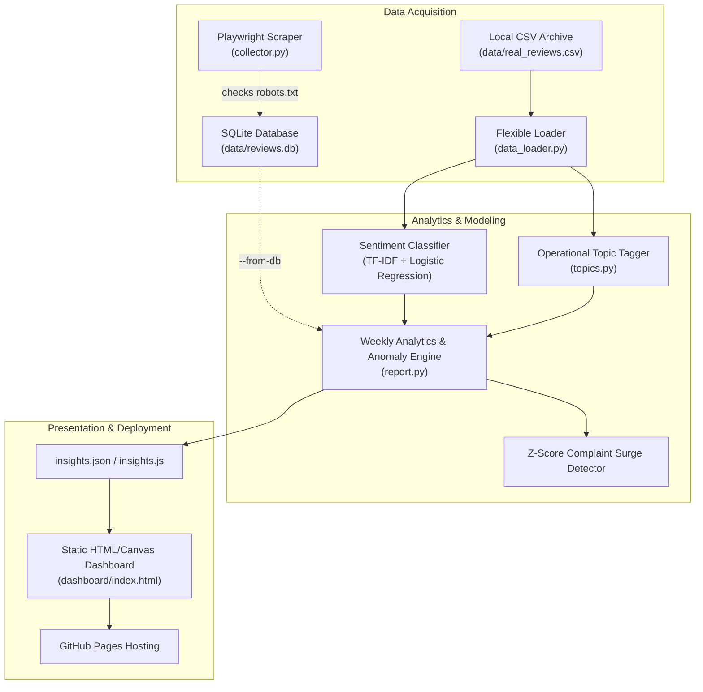

# Customer Review Insight Agent

Feedback intelligence agent for mobile applications:
**Collect reviews $\rightarrow$ Sentiment classification $\rightarrow$ Operational topic tagging $\rightarrow$ Anomaly spike alerts & interactive dashboard.**

[](https://saket-saurabh-07.github.io/customer-review-insight-agent/)
[](https://www.python.org/)
[](https://playwright.dev/)

---

## Static Web Dashboard
- **Live Demo Link:** `https://saket-saurabh-07.github.io/customer-review-insight-agent/`
- **Data Coverage:** **Dec 2020 – Mar 2021 (Historical Archive of 7,204 Google Chrome Play Store reviews).** This dashboard displays a historical analysis batch, not live real-time streams.
- **Client Architecture:** Static single-page dashboard built with pure HTML5, CSS3, and native HTML5 Canvas 2D charts (no external charting dependencies, zero build step, zero hosting fees).

```
+------------------------------------------------------------------------+
| 📊 Customer Review Insight Agent   [Period: Dec 2020 - Mar 2021]       |
+------------------------------------------------------------------------+
| Executive Summary: 7,204 reviews analyzed | 62.8% Pos | 31.0% Neg     |
| Leading Complaint Driver: updates | Status: All Systems Nominal        |
+------------------------------------------------------------------------+
| [Total: 7,204]   [Positive: 62.8%]   [Negative: 31.0%]   [Alerts: 0]   |
+-----------------------------------+------------------------------------+
| 📈 Weekly Sentiment Trend (Canvas)| 🏷️ Topic Complaints (Negative Only)|
|  - - - Positive % (Emerald)       |   updates      [██████████] 1,244  |
|  - - - Negative % (Rose Red)      |   crashes/bugs [████] 421          |
|                                   |   login/sync   [█] 173             |
+-----------------------------------+------------------------------------+
| Audited Customer Reviews (Max 100 char excerpts, Filterable by Topic)  |
+------------------------------------------------------------------------+
```

---

## Data Source, Licensing & Privacy

- **Source:** Historical Google Chrome Android user reviews from `amarshikhar/Classify-reviews` (`chrome_reviews.csv`).
- **License Status:** **No explicit license (Unlicensed / All Rights Reserved)** in the source repository. Additionally, Section 4 of the **Google Play Terms of Service** prohibits unauthorized commercial reproduction or redistribution of user content.
- **Compliance Policy:** Because of these licensing and privacy constraints, the raw 7,204-row dataset (`data/real_reviews.csv`) is **excluded from Git tracking via `.gitignore`**. The repository tracks only:
  1. The aggregated, anonymized metrics (`dashboard/data/insights.json`).
  2. 50 completely synthetic review examples (`data/sample_reviews.csv`) for CI testing and unit verification.
- **How to Download the Dataset Locally:**
  To reproduce the full 7,204-review training and evaluation on your local machine, run:
  ```bash
  python -c "import urllib.request, pandas as pd; url='https://raw.githubusercontent.com/amarshikhar/Classify-reviews/master/chrome_reviews.csv'; pd.read_csv(url).to_csv('data/real_reviews.csv', index=False); print('Saved data/real_reviews.csv')"
  ```

---

## System Architecture & Data Flow



### End-to-End Pipeline Execution:
1. **Collector (`collector.py`):** Uses Playwright headless Chromium with `robots.txt` compliance and rate-limiting. Note: `books.toscrape.com` is used as a scraping sandbox to verify automated headless browser navigation safely. Records are stored in SQLite (`data/reviews.db`).
2. **Database to Report Flow (`report.py --from-db`):** Reads records directly from `data/reviews.db`, standardizes labels, applies topic tagging, and outputs dashboard analytics.
3. **Primary Archive Flow (`report.py`):** Aggregates the 7,204 Chrome reviews across calendar weeks, detects complaint spikes, and publishes `dashboard/data/insights.json`.

---

## Topic Tagging Breakdown

Keywords target actionable software engineering areas (generic praise like "good" or "nice" is excluded):

| Topic Bucket | Negative Complaints (1–2 Stars) | Primary Triggers |
| :--- | :---: | :--- |
| **updates** | **1,244** | `update`, `download`, `install`, `version`, `pending`, `stuck` |
| **crashes/bugs** | **421** | `crash`, `freeze`, `blank screen`, `force close`, `error`, `bug` |
| **login/sync** | **173** | `sync`, `account`, `bookmarks`, `tabs`, `login`, `history` |
| **speed/performance** | **123** | `lag`, `slow`, `sluggish`, `ram`, `memory`, `loading` |
| **battery/data** | **51** | `battery drain`, `heat`, `mobile data`, `wifi`, `bandwidth` |
| **privacy** | **36** | `tracking`, `permissions`, `incognito`, `spyware`, `cookies` |
| **ads** | **26** | `popups`, `banners`, `spam`, `commercials` |
| *other / unclassified* | *669 (30.0%)* | Short feedback without specific feature keywords |

---

## Honest Project Limitations

1. **75.0% Classification Accuracy:** Linear TF-IDF n-gram models cannot resolve nuanced human language, complex double negations, or heavy sarcasm.
2. **Weak Neutral Class Representation (F1: 0.06):** In customer feedback, 3-star ratings often combine mixed positive and negative comments (e.g., *"great app but battery drains fast"*), making bag-of-words classification noisy.
3. **Single App Dataset:** The pipeline is tuned on Google Chrome Android reviews. Transferring to fintech or e-commerce requires updating the keyword dictionary in `topics.py`.
4. **No Automated CI Data Ingestion:** The GitHub Actions cron schedule is disabled because GitHub Actions cannot scrape third-party platforms without violating rate limits or platform terms. The workflow is restricted to manual triggers (`workflow_dispatch`) with safety checks preventing sample data overwrites.

---

## Local Setup & Quick Start

```bash
# 1. Clone repository
git clone https://github.com/SAKET-SAURABH-07/customer-review-insight-agent.git
cd customer-review-insight-agent

# 2. Install dependencies (including Playwright)
pip install -r requirements.txt
playwright install chromium

# 3. (Optional) Run Playwright Review Collector to SQLite
python collector.py
# Verify report generation from SQLite:
python report.py --from-db

# 4. Generate clean baseline insights from the 7,204-review archive
python report.py

# 5. Test anomaly detection (writes to temp path, leaving dashboard intact):
python report.py --inject-spike login/sync

# 6. Preview dashboard locally
cd dashboard
python -m http.server 8000
# Open http://localhost:8000 in your browser
```
