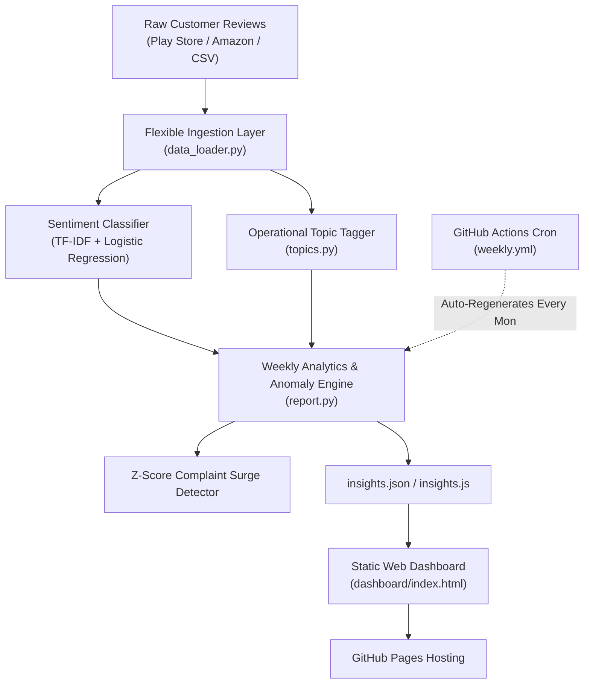

# Customer Review Insight Agent

Autonomous end-to-end customer feedback intelligence agent:
**Collect reviews $\rightarrow$ Sentiment per review $\rightarrow$ Operational topic tagging $\rightarrow$ Weekly report $\rightarrow$ Automated spike alerts & live dashboard.**

[](https://<username>.github.io/<repo>/)
[](https://www.python.org/)
[](LICENSE)

---

## Live Demo & Dashboard
- **Live Demo Link:** `https://<username>.github.io/<repo>/` *(Replace with your GitHub username and repository name)*
- **Static Architecture:** Single-page dashboard built with pure HTML5, CSS3, and vanilla Canvas 2D charts (zero framework overhead, zero build step, 100% serverless).

```
+------------------------------------------------------------------------+
| 📊 Customer Review Insight Agent                     [Live Insights]   |
+------------------------------------------------------------------------+
| Executive Summary: 7,204 reviews analyzed | 62.8% Pos | 31.0% Neg     |
| Leading Complaint Driver: app/bugs | Status: All Systems Nominal       |
+------------------------------------------------------------------------+
| [Total: 7,204]   [Positive: 62.8%]   [Negative: 31.0%]   [Alerts: 0]   |
+-----------------------------------+------------------------------------+
| 📈 Weekly Sentiment Trend (Canvas)| 🏷️ Topic Complaints (Canvas)       |
|  - - - Positive % (Emerald)       |   app/bugs  [████████████] 1,440   |
|  - - - Negative % (Rose Red)      |   support   [██] 49                |
+-----------------------------------+------------------------------------+
| Audited Customer Reviews (Gibberish Filtered, Filterable by Topic/Sent)|
+------------------------------------------------------------------------+
```

---

## System Architecture



---

## Core Components

1. **Flexible Ingestion (`data_loader.py`)**
   - Automatically detects text and rating columns across Kaggle, Amazon, Flipkart, and Play Store schemas.
   - Maps 1–2 stars $\rightarrow$ negative, 3 stars $\rightarrow$ neutral, 4–5 stars $\rightarrow$ positive.
   - Preserves timestamps for week-over-week temporal intelligence.
2. **Sentiment Model (`train_sentiment.py`)**
   - Evaluated on 7,204 real Google Play Store user reviews with an 80/20 stratified split.
   - TF-IDF (unigrams + bigrams) + Class-balanced Logistic Regression.
   - Honest test accuracy: **75.02%** (macro F1: 0.54, weighted F1: 0.76).
3. **Operational Topic Tagging (`topics.py`)**
   - Deterministic keyword-rules classifying reviews into operational categories: `app/bugs`, `support`, `quality`, `price`, `delivery`, and `other`.
4. **Insights Engine & Spike Detector (`report.py`)**
   - Calculates weekly sentiment rates and topic volume.
   - Employs a transparent z-score threshold ($Z \ge 1.3$) to detect negative complaint surges.
   - Exports `dashboard/data/insights.json` (and `insights.js` fallback).
5. **Static Analytics Dashboard (`dashboard/`)**
   - Standalone client-side application with vanilla Canvas charts and dynamic review filtering.

---

## Known Limitations

1. **75.0% Accuracy Ceiling:** Linear TF-IDF n-gram models cannot fully resolve nuanced human language, complex double negations, or heavy sarcasm.
2. **Weak Neutral Class Representation (F1: 0.06):** In customer reviews, 3-star ratings often mix polarized sentiments (e.g., *"great app but battery drains fast"*) or express vague indifference, making pure bag-of-words classification noisy.
3. **Domain Transfer:** The keyword topic dictionary is optimized for software/retail reviews; migrating to specialized domains (e.g., fintech/healthcare) requires domain-specific keyword extensions.

---

## Local Setup & Quick Start

```bash
# 1. Clone repository
git clone https://github.com/<username>/<repo>.git
cd <repo>

# 2. Install dependencies
pip install -r requirements.txt

# 3. Regenerate insights
python report.py

# 4. Preview dashboard locally
cd dashboard
python -m http.server 8000
# Open http://localhost:8000 in your browser
```
